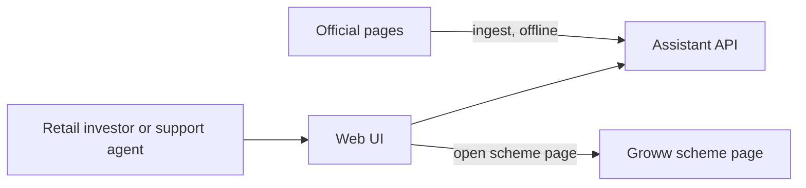
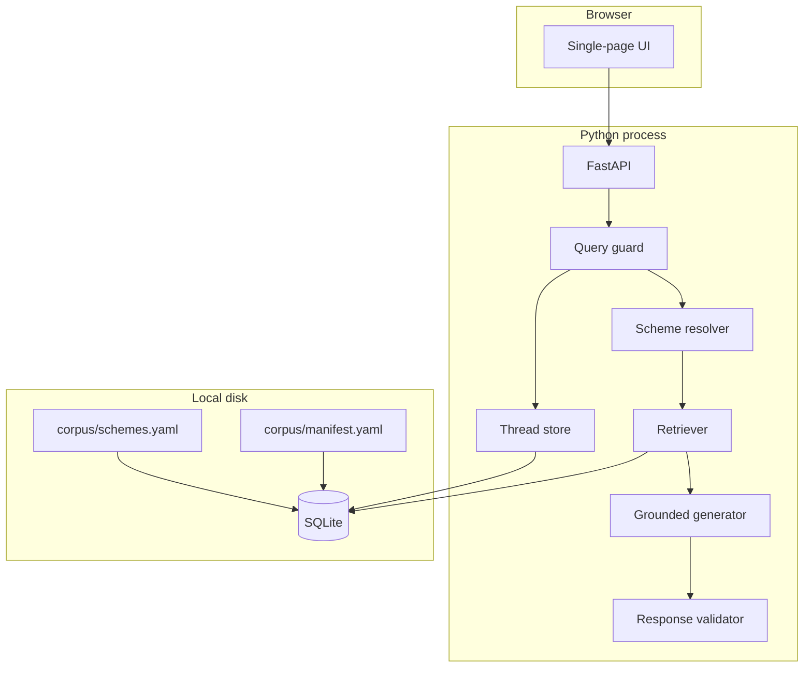
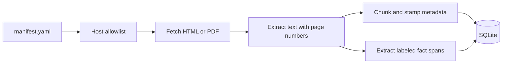
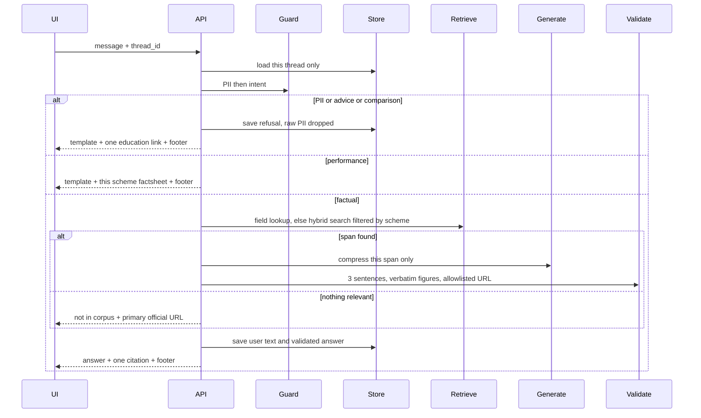

# Mutual Fund FAQ Assistant — Architecture

This document describes how to build the facts-only assistant defined in [problemstatement.md](problemstatement.md). The corpus is the source of truth. The model only compresses a retrieved passage. Compliance rules (one citation, three sentences, refusal, last-updated footer) are enforced in code after generation.

## 1. Architectural principles

1. **Closed corpus.** Answers come from a hand-curated set of 15–25 public pages on UTI Mutual Fund, AMFI, and SEBI. The ten Groww scheme URLs identify which UTI schemes are in scope. They are a product reference list, and they are not fetched or indexed.
2. **Guard before generate.** Advisory, comparison, performance, personal-data, and out-of-scope questions never reach the generator. Those paths return a fixed, reviewed template plus one allowlisted link.
3. **Numbers are copied, not recalled.** A figure in an answer (expense ratio, exit load, SIP minimum, lock-in, riskometer, benchmark) must appear as a verbatim span in the cited chunk. If the span is missing, the assistant says the fact is not in the indexed documents and links the closest official page.
4. **One citation, chosen by code.** The model does not invent URLs. The server selects the single source URL from the chunk that supported the answer. The footer date is that chunk’s retrieval date, written by the server.
5. **Thread isolation is a data rule.** Every read and write of conversation state includes `thread_id`. Scheme memory for follow-up questions lives on that thread row only.
6. **No account, no personal data.** There is no login. Messages that contain PAN, Aadhaar, account numbers, OTPs, email addresses, or phone numbers are refused and are not stored.

## 2. System context



The user talks only to the local UI. Ingestion is an offline job that pulls the allowlisted official URLs into SQLite. Groww pages are outbound links from the scheme list so a user can open the reference product. The assistant never calls Groww for an answer.

| Actor | Interaction |
| --- | --- |
| Retail investor, support, content | Ask a factual question in a thread, or click an example question |
| Ingest job | Refresh the corpus on demand and stamp every chunk with the fetch date |
| Operator | Edit the corpus manifest and the scheme registry, then re-run ingest |

Out of the runtime path: Groww accounts, order APIs, NAV feeds, registrar logins, and any site outside the host allowlist.

## 3. Containers



One process is enough. FastAPI serves the JSON API and the static UI. SQLite in WAL mode is the only database. Embeddings are computed locally, so retrieval works without an API key. Generation calls Groq’s OpenAI-compatible chat endpoint when a prose answer is required. Structured facts and every refusal skip that call.

## 4. Technology choices

| Concern | Choice | Why this fits |
| --- | --- | --- |
| API | Python 3.11, FastAPI, Pydantic | Small service, typed response contract, one command to run |
| UI | Static HTML, CSS, and a single script | Welcome line, three examples, disclaimer, and a thread list. No account UI |
| Corpus files | YAML manifest + scheme registry | The 15–25 URLs and the ten schemes stay reviewable in git |
| Fetch | `httpx` | Timeouts, size caps, and a host allowlist on every request |
| HTML extract | Trafilatura | Drops navigation and keeps article text from AMC and regulator pages |
| PDF extract | `pypdf` | SID, KIM, and factsheets are PDFs |
| Metadata store | SQLite | Chunks, scheme facts, threads, and messages in one file |
| Lexical search | SQLite FTS5 | Exact tokens such as “exit load” and scheme names |
| Vectors | Local `all-MiniLM-L6-v2`, stored as float blobs | The corpus is tiny. Brute-force cosine over a few hundred chunks is enough |
| Generation | Groq `POST /openai/v1/chat/completions` via `GROQ_API_KEY`, `GROQ_MODEL` (default `llama-3.3-70b-versatile`), and `GROQ_BASE_URL` (default `https://api.groq.com/openai/v1`) | OpenAI-compatible chat API, called with `httpx`. Prose only. Facts and refusals never call it |
| Tests | `pytest` plus a golden JSONL file | Locks the response contract and the refusal paths |

An embedding or chat provider that cannot cite the manifest is unused. If `GROQ_API_KEY` is unset, factual answers fall back to the extractive template (quoted span plus the source link). Refusals already use templates, so the demo still enforces the contract.

## 5. Repository layout

```text
Groww/
  docs/
    problemstatement.md
    architecture.md
  corpus/
    schemes.yaml          # 10 UTI schemes, aliases, Groww reference URL, factsheet URL
    manifest.yaml         # 15–25 official URLs, host-checked at load
    education.yaml        # AMFI and SEBI links used by refusal templates
  app/
    main.py               # FastAPI app, static files, routers
    settings.py
    schemes.py            # registry load and alias match
    ingest/
      fetch.py            # allowlisted GET
      parse.py            # HTML and PDF to text
      chunk.py
      extract_facts.py    # labeled spans: expense ratio, exit load, SIP, benchmark, riskometer
      run.py              # python -m app.ingest
    guard/
      pii.py
      intent.py
    rag/
      retrieve.py
      generate.py
      validate.py
      templates.py
    threads.py
    db.py
  static/
    index.html
    app.js
    styles.css
  tests/
    test_guard.py
    test_contract.py
    test_threads.py
    golden/
      questions.jsonl
  README.md
```

## 6. Scheme registry

`corpus/schemes.yaml` is the closed set of funds the assistant will discuss. Each record:

| Field | Role |
| --- | --- |
| `scheme_id` | Stable id used by chunks, threads, and the API. Example: `uti-elss` |
| `name` | Display name |
| `aliases` | Names and short forms users type (“UTI Nifty 50 index fund”, “tax saver”, “mastershare”) |
| `category` | Index, large and mid cap, flexi cap, mid cap, small cap, ELSS, hybrid, short-duration debt, or commodity FoF. Confirmed from the SID at ingest and corrected in this file if the label was wrong |
| `groww_url` | Reference link only. Shown in the scheme list. Never ingested |
| `factsheet_url` | Official UTI factsheet. Target of every performance redirect for this scheme |
| `primary_url` | Official page used when the fact itself is missing (usually the SID or KIM) |

The ten schemes, with their Groww reference pages:

| `scheme_id` | Scheme | Groww reference page |
| --- | --- | --- |
| `uti-nifty` | UTI Nifty Fund Direct Growth | https://groww.in/mutual-funds/uti-nifty-fund-direct-growth |
| `uti-small-cap` | UTI Small Cap Fund Direct Growth | https://groww.in/mutual-funds/uti-small-cap-fund-direct-growth |
| `uti-large-mid-cap` | UTI Large & Mid Cap Fund Direct Growth | https://groww.in/mutual-funds/uti-large-mid-cap-fund-direct-growth |
| `uti-equity` | UTI Equity Fund Direct Growth | https://groww.in/mutual-funds/uti-equity-fund-direct-growth |
| `uti-mastershare` | UTI Unit Scheme 1986 Mastershare Direct Growth | https://groww.in/mutual-funds/uti-unit-scheme-1986-mastershare-direct-growth |
| `uti-mid-cap` | UTI Mid Cap Fund Direct Growth | https://groww.in/mutual-funds/uti-mid-cap-fund-direct-growth |
| `uti-elss` | UTI Long Term Equity Fund (Tax Saving) Direct Growth | https://groww.in/mutual-funds/uti-long-term-equity-fund-tax-saving-direct-growth |
| `uti-balanced` | UTI Balanced Fund Direct Growth | https://groww.in/mutual-funds/uti-balanced-fund-direct-growth |
| `uti-short-term` | UTI Short Term Fund Direct Growth | https://groww.in/mutual-funds/uti-short-term-direct-growth |
| `uti-silver-etf-fof` | UTI Silver ETF Fund of Fund Direct Growth | https://groww.in/mutual-funds/uti-silver-etf-fof-direct-growth |

Alias matching is case-insensitive and runs on the user text plus the thread’s `active_scheme_id`. A follow-up that names no scheme inherits the thread’s active scheme. A message that names a different in-scope scheme switches `active_scheme_id` for that thread only. Two scheme names in one message are treated as a comparison and refused.

## 7. Corpus manifest

`corpus/manifest.yaml` lists every indexed URL. Target size is 15–25 documents, covering:

- One factsheet, KIM, or SID per scheme where UTI publishes it (these official PDFs carry expense ratio, exit load, minimum SIP, benchmark, and riskometer)
- UTI help or FAQ pages for statements and capital-gains reports
- AMFI investor-education pages, including scheme-document and riskometer explainers
- SEBI investor-education pages used for refusals and for “how mutual fund documents work”

Each entry:

```yaml
- url: https://www.utimf.com/...
  scheme_id: uti-elss          # null for AMFI/SEBI pages that apply to all schemes
  doc_type: factsheet          # factsheet | kim | sid | amc_faq | statement_guide | tax_guide | amfi | sebi
  title: UTI Long Term Equity Fund factsheet
```

### Host allowlist

The loader and the fetcher accept only these hosts:

- `utimf.com`, `www.utimf.com`
- `amfiindia.com`, `www.amfiindia.com`
- `sebi.gov.in`, `www.sebi.gov.in`, `investor.sebi.gov.in`

A URL that fails the allowlist aborts ingest for that entry and is logged. The fetcher also refuses redirects onto any other host. `groww.in` is absent from the allowlist on purpose: those ten URLs stay in `schemes.yaml` as reference links.

`corpus/education.yaml` holds the single AMFI link and the single SEBI link that refusal templates are allowed to cite. Both URLs also appear in the manifest so they are part of the curated set.

## 8. Ingestion

Ingestion is a command, `python -m app.ingest`, not a request on the chat path. Re-running it replaces chunks for the URLs in the manifest and leaves threads untouched.



For each URL:

1. GET with a 20s timeout, a 15 MB cap, and a browser-like User-Agent. Follow redirects only while the host stays on the allowlist.
2. Record `retrieved_at` in UTC at the moment the body is stored, and also keep a display date in the form `25 Oct 2026`.
3. Parse HTML with Trafilatura, or PDF page by page with `pypdf`. Drop empty pages.
4. Chunk to about 800 tokens with 120 tokens of overlap. Carry the heading path when the parser exposes it. Do not split a labeled fact row from its label when a heading such as “Exit Load” is detected; keep that row intact as its own chunk.
5. Write `scheme_facts` rows when a label matches a known field and the value is a short span on the same page: expense ratio, exit load, minimum SIP, minimum lump sum, benchmark, riskometer, lock-in. Each row stores `scheme_id`, `field`, `value_text`, `source_url`, `page`, `retrieved_at`. The value is the source text, not a normalized number the model could recompute.
6. Embed each chunk with MiniLM and store the vector beside the chunk.
7. Rebuild the FTS index.

Failed fetches are reported and skipped. A scheme with no parsed factsheet still has its registry `factsheet_url` for the performance redirect, and factual questions about it take the “not in the indexed documents” path until ingest succeeds.

Chunk metadata stored on every row: `chunk_id`, `url`, `scheme_id`, `doc_type`, `title`, `page`, `heading`, `text`, `retrieved_at`, `embedding`.

## 9. Data model

```text
schemes
  scheme_id PK, name, category, groww_url, factsheet_url, primary_url

chunks
  chunk_id PK, url, scheme_id, doc_type, title, page, heading,
  text, retrieved_at, embedding

chunks_fts
  chunk_id, text

scheme_facts
  scheme_id, field, value_text, source_url, page, retrieved_at
  PK (scheme_id, field, source_url)

threads
  thread_id PK, title, active_scheme_id, created_at, updated_at

messages
  message_id PK, thread_id FK, role, kind, text, citation_url,
  footer, created_at
```

`messages.text` for the user role is stored only after the PII guard clears it. Assistant rows store the validated display text.

`threads.active_scheme_id` is the only cross-turn memory that affects retrieval. It is never read from another thread.

## 10. Request path

`POST /api/threads/{thread_id}/messages` with `{ "text": "..." }`.



Steps in order:

1. **Load the thread.** Unknown `thread_id` returns 404. The query never selects messages from other threads.
2. **PII guard.** If PAN, Aadhaar, email, phone, OTP, or an account-number pattern matches, return the personal-data refusal. Do not write the raw text. Write nothing, or write a user row whose text is the fixed placeholder `[removed: personal data]`.
3. **Intent guard.** Classify with rules first (section 11). A match short-circuits to a template.
4. **Resolve the scheme.** From aliases in the text, else `threads.active_scheme_id`. No scheme and a scheme-specific fact: ask which of the ten schemes, in one sentence, and link the UTI page from the registry (`primary_url` of the AMC FAQ or the first AMFI page). That clarification is still at most three sentences and carries one official link.
5. **Retrieve.** For a known field, read `scheme_facts` for that `scheme_id`. Otherwise hybrid search over chunks with `scheme_id` equal to the active scheme or NULL (shared AMFI/SEBI/UTI help pages).
6. **Generate or extract.** Prefer the extractive template when `scheme_facts` has the field. Call the model only to compress a longer passage (statement download steps, a riskometer definition).
7. **Validate.** On failure, discard the model text and use the extractive template or the not-in-corpus template.
8. **Attribute.** Append `Last updated from sources: <display date>` from the cited chunk’s `retrieved_at`. Performance and refusal templates use the retrieval date of the factsheet or education page they cite.
9. **Persist and return** the structured payload in section 14.

Retrieval for a factual answer uses the current user message and the active scheme. It does not embed the whole thread history. That keeps a previous refusal or a different scheme’s numbers out of the context window.

## 11. Query guard

The guard is deterministic. A later LLM classifier is optional and can only move a query into a stricter class (factual → refusal), never the other way.

### 11.1 PII

Refuse when the text matches any of:

- PAN: five letters, four digits, one letter
- Aadhaar: 12 digits, with or without spaces
- Email address
- Indian mobile numbers and numbers with a country code
- OTP phrasing plus a 4–8 digit code
- Strings labeled account, folio, or DP id followed by a long digit run

The refusal cites the SEBI investor-education URL from `education.yaml`, tells the user the assistant does not take personal identifiers, and restates the facts-only limit. Matching substrings are not logged.

### 11.2 Intent classes

| Class | Signals | Behavior |
| --- | --- | --- |
| `advice` | should I, recommend, suitable, good time, allocate, invest in, worth buying | Template refusal. Link the AMFI education URL |
| `comparison` | better, versus, vs, which fund, compare, higher return, two in-scope scheme names | Template refusal. Same education URL |
| `performance` | return, CAGR, NAV history, alpha, ranking, “how much would I gain”, XIRR | Template. Link `factsheet_url` for the resolved scheme. No figure and no arithmetic |
| `pii` | Section 11.1 | Template refusal. Link the SEBI education URL |
| `out_of_scope` | Another AMC, a scheme not in the registry, stocks, IPOs, tax filing for a person | Template. Link the AMFI page. State that coverage is these ten UTI schemes |
| `clarify_scheme` | A scheme-specific fact with no scheme in the text and none on the thread | One question listing that a scheme is required, plus one UTI or AMFI link |
| `factual` | Expense ratio, exit load, minimum SIP, lock-in, riskometer, benchmark, statement or capital-gains download, definition grounded in a retrieved page | Retrieve and answer |
| `not_in_corpus` | Factual, but no fact row and hybrid score below the threshold | Say the indexed official documents do not contain that fact. Link `primary_url` |

Performance outranks factual. “What is the expense ratio and the 5-year return?” is `performance`, because a mixed question would otherwise quote a return beside a permitted fact.

ELSS lock-in is `factual` and must be answered from the ELSS SID or KIM span. The server does not substitute a memorized “3 years” when that span is absent.

### 11.3 Templates

Templates are complete responses: at most three sentences, one URL, then the footer. The generator is not asked to “politely refuse”, which is how advice leaks back in.

Advice template, shape:

> This assistant shares facts from official UTI, AMFI, and SEBI documents and does not provide investment advice or recommendations. Investor education material is published by AMFI. https://www.amfiindia.com/...
>
> Last updated from sources: 25 Oct 2026

Performance template, shape:

> This assistant does not calculate or quote returns, CAGR, or rankings. Published performance for UTI Nifty Fund Direct Growth is on the official factsheet. https://www.utimf.com/...
>
> Last updated from sources: 25 Oct 2026

The factsheet sentence names the resolved scheme. With no resolved scheme, the performance template asks which of the ten schemes and links the UTI factsheet index page from the manifest.

## 12. Retrieval

For a factual field that has a `scheme_facts` row, retrieval returns that row’s span and URL. Hybrid search is the fallback.

Hybrid score for a chunk:

```text
score = 0.45 * normalized_bm25 + 0.55 * cosine
```

Filters applied before scoring:

- `scheme_id` is the active scheme or NULL
- `doc_type` is preferred when the intent is known: factsheet, KIM, or SID for expense ratio, exit load, SIP, benchmark, and riskometer; `statement_guide` or `tax_guide` for download questions; `amfi` or `sebi` for definitions

Take the top 4 chunks. Keep a chunk for generation only when `score >= 0.45` or it is a fact row. Otherwise return `not_in_corpus`.

The citation URL is the URL of the fact row, or of the highest-scoring remaining chunk. Shared AMFI pages are cited for definitions. Scheme numbers are cited from the scheme’s own UTI document, so a Nifty fund expense ratio cannot be sourced from the small-cap factsheet.

## 13. Generation and validation

### 13.1 Extractive path

Used whenever `scheme_facts` has the field. The answer is built in code:

- Sentence 1 states the label, the scheme name, and `value_text` unchanged.
- Sentence 2 points at the document title.
- The citation is `source_url`.
- No adjective and no comparison with another scheme.

Example shape: “The exit load stated for UTI Mid Cap Fund Direct Growth is ‘1% if redeemed within 365 days’. This wording is from the scheme factsheet.”

### 13.2 Grounded generation path

Used for prose such as statement downloads. The prompt receives only:

- The user question
- The active scheme name
- Up to 4 chunk texts, each already tied to an allowlisted URL
- Instructions: at most 3 sentences, use only these passages, copy numbers exactly, do not recommend, do not compute, if the passages do not contain the answer say so

The model returns JSON:

```json
{
  "sentences": ["...", "..."],
  "supported": true
}
```

The server ignores any URL the model emits. `supported: false` selects the not-in-corpus template.

Sampling is temperature 0, sent to Groq at `GROQ_BASE_URL` with model `GROQ_MODEL`. Groq accepts 0 and records it as `1e-8`. The context window contains no other thread and no previous answers, so the model cannot recycle an earlier citation. The call is made with `httpx` only when `GROQ_API_KEY` is set.

### 13.3 Validator

The validator rejects the model output when any check fails, and the server substitutes the extractive or not-in-corpus template:

| Check | Rule |
| --- | --- |
| Sentence count | 1 to 3 sentences in the joined answer |
| Citation host | URL host is on the allowlist and the URL is in the manifest |
| Citation unity | Exactly one URL in the whole reply |
| Figure grounding | Every number and percent in the answer occurs in the cited chunk text |
| Banned effect | No recommendation to buy, sell, switch, or prefer a scheme. Performance replies contain no return figure |
| Footer | Exactly one line, `Last updated from sources: <date>`, date equal to the cited document’s `retrieved_at` |
| PII echo | The answer contains no PAN, Aadhaar, email, or phone pattern |

The UI renders `text`, the citation as a link, and `footer` from separate JSON fields so a layout change cannot drop the source.

## 14. HTTP API

Base path `/api`. JSON only. No cookies and no auth headers.

### `POST /api/threads`

Creates a thread. Response: `{ "thread_id", "title", "created_at" }`. `thread_id` is a UUID.

### `GET /api/threads`

Returns threads for this local database, newest first: `thread_id`, `title`, `active_scheme_id`, `updated_at`. This is a single-operator local app. The list is every thread in the file, and the UI keeps them visually separate.

### `GET /api/threads/{thread_id}`

Returns the thread plus its messages in order. Each message: `role`, `kind`, `text`, `citation`, `footer`, `created_at`.

### `POST /api/threads/{thread_id}/messages`

Request: `{ "text": "What is the exit load for UTI ELSS?" }`

Response:

```json
{
  "thread_id": "…",
  "message_id": "…",
  "kind": "answer",
  "scheme_id": "uti-elss",
  "text": "…one to three sentences…",
  "citation": {
    "url": "https://www.utimf.com/…",
    "title": "…",
    "doc_type": "factsheet"
  },
  "footer": "Last updated from sources: 25 Oct 2026"
}
```

`kind` is one of `answer`, `refusal`, `performance_redirect`, `clarify_scheme`, `not_in_corpus`.

Errors: `404` unknown thread, `422` empty text, `413` text over 1,000 characters. A PII hit is `200` with `kind: "refusal"`, because refusal is a successful behavior.

### `GET /api/schemes`

Returns the ten schemes: `scheme_id`, `name`, `category`, `groww_url`. The UI uses this for the scheme list and for example questions. `groww_url` is rendered as an external reference, never as a citation.

### `GET /api/health`

Returns `{ "ok": true, "schemes": 10, "documents": <manifest count>, "last_ingest": "<iso>" }`.

## 15. Threads and concurrency

- A thread is created before the first message. The UI can open several threads and keep their transcripts in separate panels or a sidebar plus a message pane.
- The title is the first factual question, truncated, or “New conversation” until then.
- `active_scheme_id` updates only inside the handler for that `thread_id`, in the same transaction as the new messages.
- SQL is parameterized and every message query has `WHERE thread_id = ?`.
- SQLite WAL allows a message in thread A and a message in thread B at the same time. Each handler loads one thread row. There is no process-wide “current scheme” or “last answer”.
- Deleting a thread deletes its messages and nothing else. The corpus stays.

The UI sends `thread_id` on every ask. It does not rely on a server-side session. Two browser tabs with two ids are two conversations.

## 16. User interface

One page. The disclaimer is in the header on every thread: **Facts-only. No investment advice.**

Layout:

- Left column: “New chat” and the thread list. The active thread is highlighted. Creating a thread does not copy messages.
- Main column: welcome state or the transcript.
- Welcome state, shown on an empty thread: one short paragraph of what the assistant answers (expense ratio, exit load, minimum SIP, ELSS lock-in, riskometer, benchmark, statement and capital-gains download steps) and the sentence that it will refuse advice and comparisons. Under that, three buttons.
- Composer: a text field and Send. The scheme is inferred from the question. A small line under the composer shows the thread’s active scheme once one is resolved.

The three example questions, wired as button clicks that send into the active thread:

1. What is the expense ratio of UTI Nifty Fund Direct Growth?
2. What is the ELSS lock-in period for UTI Long Term Equity Fund (Tax Saving) Direct Growth?
3. How do I download a mutual fund capital gains statement?

The third example is a procedure question. If the indexed UTI or AMFI page describes the steps, the answer cites that page. It does not cite Groww.

Each assistant bubble shows the sentences, one link with the document title, and the footer in muted text. Refusal bubbles use the same layout so the education link is obvious. The Groww reference for the active scheme sits in the sidebar as “View on Groww”, separate from the citation, so the official source and the product page cannot be confused.

The page stores nothing in cookies. Thread ids sit in memory and in the server list. The input placeholder asks users not to paste PAN, Aadhaar, account numbers, OTPs, email, or phone numbers.

## 17. Configuration

Environment variables:

| Variable | Required | Purpose |
| --- | --- | --- |
| `GROQ_API_KEY` | No | Groq key for prose answers. Empty means extractive answers only. Sent to Groq, never logged |
| `GROQ_MODEL` | No | Default `llama-3.3-70b-versatile` |
| `GROQ_BASE_URL` | No | Default `https://api.groq.com/openai/v1` |
| `DATABASE_PATH` | No | Default `data/assistant.db` |
| `EMBEDDING_MODEL` | No | Default `sentence-transformers/all-MiniLM-L6-v2`. Local model, not a Groq model |

No secret belongs in the manifest or the scheme registry. The README states that the app stores no PAN, Aadhaar, account numbers, OTPs, emails, or phone numbers.

## 18. How the response contract is met

| Requirement | Where it is enforced |
| --- | --- |
| Facts only | Intent guard plus “use only these passages” plus figure grounding |
| Official sources only | Host allowlist at ingest, citation check against the manifest |
| At most 3 sentences | Templates and the validator |
| Exactly one link | Server sets `citation`; validator rejects a second URL |
| Last-updated footer | Server writes it from `retrieved_at` |
| Performance stays on the factsheet | `performance` class skips the generator |
| Advice and comparisons refused | `advice` and `comparison` classes skip the generator |
| Personal data not stored | PII guard runs before insert |
| Independent threads | `thread_id` predicate and per-thread `active_scheme_id` |
| Groww is context, not the corpus | Scheme registry holds the ten URLs; the fetcher cannot request that host |

## 19. Testing

Golden file `tests/golden/questions.jsonl`. Each row has `thread`, `question`, `expect_kind`, and either `expect_scheme_id` plus a citation host or `expect_url_substr`.

Minimum set:

- One factual question per field (expense ratio, exit load, minimum SIP, lock-in, riskometer, benchmark) on at least three schemes with different categories, including the ELSS scheme and one debt or commodity scheme.
- Statement or capital-gains download.
- “Should I invest in UTI Small Cap Fund?” → `refusal`
- “Which is better, UTI Nifty or UTI Mid Cap?” → `refusal`
- “What is the 5-year return of UTI Equity Fund?” → `performance_redirect` and a `utimf.com` factsheet URL, and the text contains no percent
- A PAN pasted into a question → `refusal`, and the messages table does not contain the PAN
- Two threads in one test: thread A sets UTI ELSS, thread B sets UTI Nifty, then each asks “What is the expense ratio?”. Citations and scheme names must match the thread’s own scheme.
- A question about a non-UTI fund → `out_of_scope` mapped to `refusal`
- A factual question whose field was removed from the fixture database → `not_in_corpus`, with no invented number

Contract tests also run the validator on deliberately bad model JSON: four sentences, a `groww.in` URL, a percent that is not in the chunk, and a missing footer.

## 20. Run sequence

1. Create a virtualenv, install dependencies, and download the embedding model once.
2. Fill `corpus/schemes.yaml` with the ten rows in section 6 and `corpus/manifest.yaml` with 15–25 allowlisted URLs. Point each scheme’s `factsheet_url` at the UTI PDF or HTML factsheet.
3. `python -m app.ingest`
4. `uvicorn app.main:app` and open the UI.
5. Confirm `/api/health` shows 10 schemes and the manifest document count.
6. Run `pytest`. Then click the three examples and open a second thread while the first still shows its own history.

The README covers these commands, names UTI Mutual Fund, lists the ten schemes and Groww reference URLs, summarizes this pipeline, and states the limitations below. It prints the disclaimer: Facts-only. No investment advice.

## 21. Limitations carried into the design

- Coverage stops at these ten UTI schemes. Other funds hit the out-of-scope template.
- `Last updated from sources` is the ingest time of the cited URL. It changes only when ingest runs again. It is not a live NAV or a live factsheet feed.
- PDF quality drives extraction quality. A scanned factsheet with no text layer produces no fact rows, and those questions take the not-in-corpus path rather than a guessed number.
- The assistant quotes published rules. It does not decide whether a lock-in or exit load applies to a particular folio.
- Statement steps are only as complete as the UTI, AMFI, or SEBI page in the manifest. Registrar portals are outside the allowlist.
- Thread listing is local and unauthenticated. That matches a single-operator tool and is the wrong shape for a public multi-tenant deployment.

## 22. What this architecture leaves out

No Groww login, no order placement, no portfolio or holdings lookup, no NAV stream, no return calculator, no cross-AMC index, and no account system. Adding any of those would break the facts-only boundary the rest of the pipeline is built to hold.
