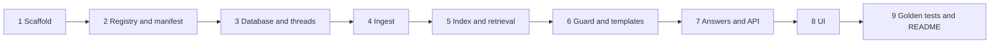

# Mutual Fund FAQ Assistant — Implementation Plan

Phase-wise plan for the facts-only UTI assistant in [problemstatement.md](problemstatement.md) and [architecture.md](architecture.md). Each phase ends with something that runs and a check that later phases must not break. The corpus stays the source of truth: the model is added only after extractive answers and refusals already meet the response contract.

## 1. How to use this plan

Work the phases in order. A phase is done when its exit criteria pass, not when the files exist. Later phases may add files listed earlier, and they may not weaken a check that already passed (allowlist, PII storage, thread filter, one citation, three sentences).

Do not start the UI before `POST /api/threads/{id}/messages` returns a validated payload. Do not call a chat model before the guard tests prove that advice, comparison, performance, and personal-data questions never reach it.

Stack, endpoints, schema, and templates are already chosen in the architecture. This plan does not reopen those choices, except the chat provider: Groq fills the architecture’s OpenAI-compatible `/chat/completions` slot.

**Chat provider.** Groq is the only chat model in this project. Phase 7 calls it with `httpx` at `POST {GROQ_BASE_URL}/chat/completions`, using the HTTP client already in this phase’s dependencies. The default model is `llama-3.3-70b-versatile`, a current Groq production model. Embeddings stay on local `all-MiniLM-L6-v2` and stay on this machine.

| Variable | When blank | Meaning |
| --- | --- | --- |
| `GROQ_API_KEY` | Stays blank | No chat model. Structured facts and refusals still run. The key is never logged. |
| `GROQ_MODEL` | `llama-3.3-70b-versatile` | Model id sent on every Groq request |
| `GROQ_BASE_URL` | `https://api.groq.com/openai/v1` | Groq’s OpenAI-compatible origin. A blank key does not clear this URL |
| `DATABASE_PATH` | `data/assistant.db` | SQLite file, created in later phases |
| `EMBEDDING_MODEL` | `sentence-transformers/all-MiniLM-L6-v2` | Local embedding id, used from Phase 5 |

Later phases turn the chat model off by leaving `GROQ_API_KEY` empty. Groq accepts `temperature: 0` and stores it as `1e-8`. Phase 7 still sends `0`. The request asks for JSON `{ "sentences", "supported" }` and the server ignores any URL in the model text.

## 2. Phase map

| Phase | Outcome | Success criteria unlocked |
| --- | --- | --- |
| 1 | App boots | — |
| 2 | Ten schemes and 15–25 official URLs, host-checked | No non-official source can enter the corpus |
| 3 | Independent threads in SQLite | Two threads do not share rows |
| 4 | Chunks and fact spans with retrieval dates | Facts can be copied from source text |
| 5 | Scheme-filtered hybrid search | The right scheme document is retrieved |
| 6 | Refusals without a model | Advice, comparison, performance, and PII are refused |
| 7 | Contract-valid answers on the API | Three sentences, one citation, footer, no invented figures |
| 8 | Minimal UI | Welcome, three examples, disclaimer, parallel threads |
| 9 | Golden suite and README | Full success list in the problem statement |

## 3. Phase 1 — Scaffold

**Goal.** A Python 3.11 process that serves a health check and an empty page, with configuration and a gitignore that keeps the database and API keys out of the tree.

**Depends on.** Nothing.

**Build.**

- `requirements.txt` (or `pyproject.toml`) with FastAPI, Uvicorn, Pydantic, PyYAML, httpx, trafilatura, pypdf, and pytest. Leave `sentence-transformers` for Phase 5 so this phase installs quickly.
- `app/settings.py` reading `GROQ_API_KEY`, `GROQ_MODEL`, `GROQ_BASE_URL`, `DATABASE_PATH`, and `EMBEDDING_MODEL`, with the defaults in the chat-provider table. A blank `GROQ_API_KEY` means no chat model. The process boots with every variable blank.
- `app/main.py` with `GET /api/health` returning `{ "ok": true, "schemes": 0, "documents": 0, "last_ingest": null }` and StaticFiles mounted at `/` for `static/`.
- `static/index.html` with the disclaimer line already visible: **Facts-only. No investment advice.**
- `.gitignore` for `.venv/`, `data/`, `.env`, and model caches.
- `.env.example` listing the variables with empty values. No real key.

**Exit criteria.**

- `uvicorn app.main:app` starts and `/api/health` returns the empty payload.
- The page shows the disclaimer.
- `.env` is ignored.

**Defer.** Schemes, database tables, ingest, chat.

## 4. Phase 2 — Scheme registry and corpus manifest

**Goal.** The closed set of ten UTI schemes and 15–25 official documents, rejected if a URL is not on the host allowlist. Groww URLs exist only as reference links.

**Depends on.** Phase 1.

**Build.**

- `corpus/schemes.yaml` with one row per scheme in architecture section 6: `scheme_id`, `name`, `aliases`, `category`, `groww_url`, `factsheet_url`, `primary_url`.
- `corpus/manifest.yaml` with 15–25 entries: `url`, `scheme_id` (null for shared AMFI, SEBI, and UTI help pages), `doc_type`, `title`. Cover a factsheet, KIM, or SID for each scheme where UTI publishes one, plus a statement or capital-gains guide and the education pages.
- `corpus/education.yaml` with exactly one AMFI URL and one SEBI URL. Those same URLs are also manifest entries.
- `app/schemes.py` loading both YAML files. The loader’s allowlist is only `utimf.com`, `www.utimf.com`, `amfiindia.com`, `www.amfiindia.com`, `sebi.gov.in`, `www.sebi.gov.in`, and `investor.sebi.gov.in`.
- Alias index: lowercase name and aliases mapped to one `scheme_id`. A string that maps to two schemes is flagged for the comparison guard later.
- Research step, done before coding the fetcher: open UTI’s public document library and copy factsheet, KIM, and SID links into the manifest. Confirm each `factsheet_url` is on `utimf.com`. If a scheme has no text-layer PDF, record that in a short comment in the manifest and point `primary_url` at the best official HTML page. Do not substitute a Groww page.

**Tests.**

- Ten schemes load, ids match the architecture table, and every `groww_url` is present.
- Every manifest and education URL is on the allowlist.
- A fixture manifest that contains `https://groww.in/...` fails the loader.
- A redirect target test is reserved for Phase 4; here, reject the URL at parse time.

**Exit criteria.**

- Loader reports 10 schemes and a document count between 15 and 25.
- Health can later read these counts. For now a unit test asserts them.
- No Groww URL is accepted as a corpus document.

**Defer.** Downloading the documents. Categories may be corrected after a SID is actually parsed in Phase 4. Until then use the categories named in the problem statement.

## 5. Phase 3 — Database and thread store

**Goal.** SQLite in WAL mode holds schemes, chunks, facts, threads, and messages. Thread APIs exist before any answer logic, so isolation is true from the first insert.

**Depends on.** Phase 2, so scheme ids are real.

**Build.**

- `app/db.py` creating the tables in architecture section 9, foreign keys on, WAL enabled. `chunks.embedding` is a blob and may be null until Phase 5. Rebuild `chunks_fts` as an external-content FTS5 table.
- Seed `schemes` from `schemes.yaml` on startup.
- `app/threads.py`:
  - `POST /api/threads` creates a UUID thread titled `New conversation`.
  - `GET /api/threads` lists threads newest first.
  - `GET /api/threads/{thread_id}` returns the thread and its messages, or 404.
  - `POST /api/threads/{thread_id}/messages` accepts `{ "text" }`, rejects empty text with 422 and text over 1,000 characters with 413, and stores a user row plus a placeholder assistant row. The placeholder is removed in Phase 7 when the real pipeline replaces it. This phase’s handler must already query messages with `WHERE thread_id = ?` only.
- `active_scheme_id` stays null until Phase 7 updates it inside the same transaction as the new messages.
- Parameterized SQL only.

**Tests.**

- Create two threads, post a different message to each, and assert each GET returns only its own text.
- Unknown thread id returns 404.
- Empty body returns 422. A 1,001-character body returns 413.
- Re-opening the process shows the same threads (the file is the store).

**Exit criteria.**

- Two concurrent requests against two thread ids cannot read each other’s messages. A test that fires both posts and then reads both transcripts is enough.
- The corpus tables exist and are empty of chunks.

**Defer.** PII redaction (Phase 6 runs before the insert in the final handler), retrieval, and the real assistant payload.

## 6. Phase 4 — Ingestion

**Goal.** `python -m app.ingest` fetches allowlisted URLs, parses HTML and PDF, chunks them, extracts labeled fact spans, and stamps every row with `retrieved_at`. Re-running replaces chunks and leaves threads alone.

**Depends on.** Phases 2 and 3.

**Build.**

- `app/ingest/fetch.py`. GET with a 20s timeout and a 15 MB cap. Follow redirects only while the next host is on the allowlist. A hop to any other host, including `groww.in`, fails that entry.
- `app/ingest/parse.py`. HTML via Trafilatura. PDF via `pypdf`, page by page. Drop empty pages. Keep page numbers.
- `app/ingest/chunk.py`. About 800 tokens, 120 overlap. If a heading matches Exit Load, Expense Ratio, SIP, Benchmark, Riskometer, or Lock-in, keep that block as its own chunk so the label and the value stay together.
- `app/ingest/extract_facts.py`. From those blocks, write `scheme_facts` for `expense_ratio`, `exit_load`, `minimum_sip`, `minimum_lumpsum`, `benchmark`, `riskometer`, and `lock_in`. Store the source span as `value_text`. Skip the row when the scheme id is null. Do not invent a lock-in of three years when the span is missing.
- `app/ingest/run.py`. For each manifest entry: fetch, parse, delete prior chunks and facts for that URL, insert new rows, set `retrieved_at` in UTC and a display date such as `25 Oct 2026`. Log failures and continue. Print a summary: documents ok, documents failed, fact rows per scheme.
- Record `last_ingest` so `/api/health` can return it, along with scheme and document counts.

**Tests.**

- Fixture HTML and a tiny PDF go through parse, chunk, and fact extraction without the network. An “Exit Load” heading and `1% if redeemed within 365 days` become one fact row whose `value_text` contains that string unchanged.
- A redirect fixture to `groww.in` is rejected and writes no chunk.
- Ingest against a temporary database that already has a thread still has that thread after ingest.
- A failed URL does not delete other URLs’ chunks.

**Exit criteria.**

- A real ingest against the manifest completes and reports per-scheme fact coverage. Schemes with zero fact rows are listed, not filled in by hand.
- Every chunk has `url`, `scheme_id` or null, `doc_type`, `title`, `retrieved_at`, and text.
- Health shows 10 schemes, the manifest count, and a non-null `last_ingest`.

**Defer.** Embeddings. Hybrid search is next. Fact patterns will need a second pass once real UTI PDFs are inspected; budget that revision inside this phase before moving on.

## 7. Phase 5 — Index and retrieval

**Goal.** A factual query for one scheme returns that scheme’s fact row, or the top official chunks, and cannot cite another scheme’s factsheet for a number.

**Depends on.** Phase 4, with a populated local database (or a fixture database in tests).

**Build.**

- Add `sentence-transformers` and embed chunks with `all-MiniLM-L6-v2` at the end of ingest. Store float32 blobs on `chunks.embedding`. Re-ingest once so existing chunks gain vectors.
- Rebuild FTS5 over chunk text.
- `app/rag/retrieve.py`:
  - If the field is known and `scheme_facts` has a row for that `scheme_id`, return that span and its `source_url`. This path wins over search.
  - Otherwise score chunks with `scheme_id = active scheme OR scheme_id IS NULL` using `0.45 * normalized BM25 + 0.55 * cosine`.
  - Prefer `doc_type` as in the architecture: factsheet, KIM, or SID for scheme fields; `statement_guide` or `tax_guide` for download questions; `amfi` or `sebi` for definitions.
  - Keep the top 4. Drop chunks under `0.45` unless they are fact rows. Below the threshold, return an empty result so Phase 7 can emit `not_in_corpus`.
  - The citation candidate is the fact-row URL, or the highest-scoring chunk’s URL. It must belong to the active scheme or to a shared document.

**Tests.**

- Fixture: two schemes, each with an expense-ratio fact. A query bound to `uti-nifty` returns the Nifty span, not the small-cap span.
- A shared AMFI chunk with a null `scheme_id` is eligible. A third scheme’s chunk is not.
- An empty fact table and a low score return no chunks.
- Download-intent retrieval prefers `statement_guide` / `tax_guide` when both those and a factsheet contain the word “statement”.

**Exit criteria.**

- Retrieval is a pure function of `(question, scheme_id, field)` plus the database. It does not read thread messages.
- Tests pass with `GROQ_API_KEY` unset.

**Defer.** The chat model. Generation is not required to prove retrieval.

## 8. Phase 6 — Guard and templates

**Goal.** Personal data, advice, comparisons, performance questions, and out-of-scope funds are classified by rules and answered from fixed templates. The generator function is not called.

**Depends on.** Phase 2 for education URLs and scheme aliases. Phase 3 is not required to unit-test the guard. Wire the guard into the message handler in Phase 7, but keep the pure functions here so they can be tested without HTTP.

**Build.**

- `app/guard/pii.py` for PAN, Aadhaar (12 digits), email, Indian mobile numbers, OTP plus a 4–8 digit code, and account, folio, or DP id plus a long digit run. The function returns match/no-match and never logs the substring.
- `app/guard/intent.py` returning one class: `pii`, `advice`, `comparison`, `performance`, `out_of_scope`, `clarify_scheme`, `factual`. Apply them in that priority. Performance outranks factual, so a question that asks for both expense ratio and 5-year return is `performance`. Two in-scope scheme names, or signals such as better, versus, vs, compare, which fund, are `comparison`. Another AMC, a scheme not in the registry, stocks, or IPO are `out_of_scope`.
- Scheme resolution lives next to intent: aliases in the text, else the thread’s `active_scheme_id` (passed in, not read globally). No scheme for a scheme-specific fact returns `clarify_scheme`. A new in-scope scheme replaces the previous one for this call’s result only. The caller persists it in Phase 7.
- `app/rag/templates.py` building the full text for refusal, performance redirect, clarify, and not-in-corpus. Each template is at most three sentences, contains exactly one URL from the allowlist, and accepts a display date. Advice and comparison cite the AMFI education URL. PII cites the SEBI education URL. Performance cites the resolved scheme’s `factsheet_url` and names that scheme. Performance with no scheme asks which of the ten schemes and cites the UTI factsheet index URL from the manifest. Not-in-corpus cites that scheme’s `primary_url`.
- Footer helper: `Last updated from sources: <date>` using the cited document’s display date. For templates, pass the ingest date of the cited education page or factsheet.

**Tests.** `tests/test_guard.py` covering:

- “Should I invest in UTI Small Cap Fund?” → `advice`
- “Which is better, UTI Nifty or UTI Mid Cap?” → `comparison`
- “What is the 5-year return of UTI Equity Fund?” → `performance`, and the template text contains no percent
- “What is the expense ratio and the 5-year return?” → `performance`
- A realistic PAN → `pii`
- “What is the exit load of HDFC Flexi Cap?” → `out_of_scope`
- “What is the exit load?” with no thread scheme → `clarify_scheme`
- “What is the exit load?” with thread scheme `uti-elss` → `factual` and `uti-elss`
- “What is the exit load of UTI Nifty Fund?” when the thread scheme is `uti-elss` → `factual` and `uti-nifty`
- A spy or a missing generate function: template builders do not import the chat client

**Exit criteria.**

- Every refusal class has a template with one allowlisted link and a footer line.
- ELSS lock-in is classified as `factual`, not as a hardcoded answer.

**Defer.** Wiring into HTTP and storing the redacted user message. That is the first task of Phase 7 so the storage rule and the route land together.

## 9. Phase 7 — Answers, validation, and the message API

**Goal.** The message endpoint implements the full request path. Structured facts are quoted. Prose is compressed only from retrieved chunks. Anything the validator rejects is replaced. Personal data is not stored.

**Depends on.** Phases 3, 5, and 6.

**Build.**

- `app/rag/generate.py`.
  - Extractive path when `scheme_facts` has the field: sentence 1 is the scheme name, the label, and `value_text` unchanged; sentence 2 names the document title; citation is `source_url`. No suitability adjectives.
  - Grounded path when the result is prose chunks and `GROQ_API_KEY` is set. `POST {GROQ_BASE_URL}/chat/completions` with `httpx`, `Authorization: Bearer <GROQ_API_KEY>`, and `model` set to `GROQ_MODEL`. Send only the question, the scheme name, and up to four chunks. Temperature 0. Ask for JSON `{ "sentences", "supported" }`. Ignore any URL in the model output. `supported: false` selects not-in-corpus. A 4xx, 5xx, or timeout drops to the extractive path or not-in-corpus.
  - When `GROQ_API_KEY` is unset, prose uses an extractive fallback: up to two sentences cut from the best chunk, plus the citation. Still run the validator.
- `app/rag/validate.py` with the checks in architecture section 13.3: 1–3 sentences, citation host on the allowlist and present in the manifest, exactly one URL, every number and percent present in the cited chunk, no buy/sell/switch/prefer language, one footer whose date equals the chunk’s display date, no PII pattern in the answer. On failure, substitute the extractive template or not-in-corpus. Do not return the rejected model text.
- Replace the Phase 3 placeholder handler with the path in architecture section 10:
  1. Load this thread or 404.
  2. PII guard. On a hit, respond `200` with `kind: "refusal"`. Persist the user text as `[removed: personal data]` or persist nothing for the raw text. Never write the identifier.
  3. Intent guard. Template kinds skip generate.
  4. Resolve the scheme. `clarify_scheme` returns without retrieval.
  5. Retrieve. Empty result → `not_in_corpus`.
  6. Extract or generate, then validate.
  7. Server writes the footer from `retrieved_at`.
  8. In one transaction, update `active_scheme_id`, set the thread title from the first factual question if it is still `New conversation`, and insert the user and assistant rows.
- Response shape from architecture section 14, with `kind` of `answer`, `refusal`, `performance_redirect`, `clarify_scheme`, or `not_in_corpus`. Map `out_of_scope` to `kind: "refusal"`.
- The Groq client is constructed only inside the grounded path, and only when `GROQ_API_KEY` is set. Guard branches must not instantiate it. A unit test can patch the client and assert it was not called for advice, comparison, performance, and PII.

**Tests.** `tests/test_contract.py` and `tests/test_threads.py`.

- Expense ratio for a fixture scheme returns `answer`, at most three sentences, one `utimf.com` URL, a footer, and the fixture figure.
- Removing that fact row returns `not_in_corpus` and does not contain a made-up percent.
- Performance response cites `factsheet_url` and contains no percent.
- PAN question: response is a refusal, and `SELECT text FROM messages` does not contain the PAN.
- Validator rejects four sentences, a `groww.in` URL, a percent absent from the chunk, and a missing footer. Each rejection becomes a safe template.
- Two threads: thread A on UTI ELSS and thread B on UTI Nifty both ask “What is the expense ratio?”. Citations and scheme names match the thread’s own scheme.
- A second message on thread A with no scheme name still uses UTI ELSS.

**Exit criteria.**

- The API meets the response contract with `GROQ_API_KEY` unset for fact questions, and with it set for one prose question if a Groq key is available.
- A bad model payload cannot change the citation or add a fourth sentence.
- Thread isolation tests from Phase 3 still pass.

**Defer.** Visual layout. The API is the product until Phase 8.

## 10. Phase 8 — User interface

**Goal.** A single page that a retail or support user can operate: disclaimer, welcome, three examples, a thread list, and answers that always show one source and the footer.

**Depends on.** Phase 7. The UI calls the API and does not assemble citations itself.

**Build.** In `static/index.html`, `static/styles.css`, and `static/app.js`.

- Header disclaimer on every view: **Facts-only. No investment advice.**
- Sidebar: New chat, thread list from `GET /api/threads`, active thread highlighted. New chat calls `POST /api/threads` and loads an empty transcript. It does not copy messages.
- Empty thread: short welcome stating the factual topics and that advice and comparisons are refused, then three buttons that send:
  1. What is the expense ratio of UTI Nifty Fund Direct Growth?
  2. What is the ELSS lock-in period for UTI Long Term Equity Fund (Tax Saving) Direct Growth?
  3. How do I download a mutual fund capital gains statement?
- Composer with Send. Placeholder: do not paste PAN, Aadhaar, account numbers, OTPs, email, or phone numbers. Enforce the 1,000-character cap in the client as well as the server.
- Under the composer, show the active scheme name once `scheme_id` is known.
- Assistant bubbles render `text`, then `citation` as a link using `citation.title` and `citation.url`, then `footer` in muted text. The same layout is used for refusals so the education link is visible.
- Sidebar link “View on Groww” uses `groww_url` from `GET /api/schemes` for the active scheme. That anchor is separate from the citation and is never filled from `citation.url`.
- No cookies and no local storage of message text. The open thread id may live in the page’s memory. The server remains the list of threads.
- Two tabs are two threads when each has posted to its own id. Verify this in the browser.

**Exit criteria.** Checked in the browser against a database that has been ingested:

- Disclaimer is visible before the first question.
- Each example sends, and the bubble shows at most three sentences, one link, and the footer.
- The citation host is `utimf.com`, `amfiindia.com`, or `sebi.gov.in`.
- “Should I invest in this fund?” in a thread that already has a scheme returns a refusal and an AMFI or SEBI link, with no recommendation.
- “What is the 5-year return?” returns a factsheet link and no return figure.
- Opening a second thread and asking about a different scheme leaves the first transcript unchanged.
- “View on Groww” and the citation are different elements. The citation is not a `groww.in` link.

**Defer.** Accounts, theme polish beyond a readable layout, and mobile perfection. Check a narrow viewport only far enough to confirm the disclaimer, the composer, and the citation remain visible.

## 11. Phase 9 — Golden suite and README

**Goal.** The problem statement’s success list is locked in tests and written up so someone else can run the assistant.

**Depends on.** Phases 4 through 8. Golden questions that need real fact spans use the ingested database or a committed fixture built from sanitized excerpts of those spans. Prefer a fixture so pytest does not fetch the network.

**Build.**

- `tests/golden/questions.jsonl` with the minimum set in architecture section 19: one question each for expense ratio, exit load, minimum SIP, lock-in, riskometer, and benchmark across at least three categories, including ELSS and either the short-term fund or the silver FoF; a statement or capital-gains question; the advice, comparison, performance, PAN, two-thread, out-of-scope, and missing-fact cases.
- A runner that posts each row into the thread named by the fixture and asserts `kind`, scheme id, and citation host or URL substring.
- `README.md` with:
  - What the assistant is, the disclaimer **Facts-only. No investment advice.**, and the statement that it stores no PAN, Aadhaar, account numbers, OTPs, emails, or phone numbers.
  - UTI Mutual Fund as the AMC, the ten schemes, and their Groww reference URLs.
  - Pointer to `corpus/manifest.yaml` for the 15–25 official sources.
  - Setup: virtualenv, install, `python -m app.ingest`, `uvicorn app.main:app`, `/api/health`, `pytest`.
  - A short architecture summary: ingest, guard, retrieve, extract or generate, validate, per-thread state.
  - Known limitations from architecture section 21, including freshness, PDF text layers, no folio-specific interpretation, and registrar sites being outside the allowlist.
  - Groq as the chat provider, `llama-3.3-70b-versatile` as the default model, and the note that an unset `GROQ_API_KEY` still answers structured facts and refusals.

**Exit criteria.**

- `pytest` passes without a network call and without an API key.
- README setup steps match the commands that actually run.
- Health after the documented ingest shows 10 schemes and a document count from 15 to 25.
- A manual pass of the three example questions and one refusal matches the problem statement’s example interactions.

## 12. Rules that apply in every phase

- Groww URLs stay in `schemes.yaml` and the sidebar. They are not fetched, embedded, or returned as `citation.url`.
- Figures in answers are copied from `value_text` or from the cited chunk. A missing span becomes `not_in_corpus`.
- Templates, not the model, write refusals and performance redirects.
- Every message query includes `thread_id`. There is no process-wide current scheme.
- PII matches are not logged and not stored.
- Dependencies stay inside the phase that needs them. Do not add a vector database, a frontend framework, an account system, or a chat SDK. Groq is called with `httpx` from the grounded path only.
- An empty `GROQ_API_KEY` keeps generation on the extractive fallback. Refusals and performance redirects never call Groq.
- Out of scope for the whole plan: advice, orders, NAV, holdings, return math, other AMCs, registrar logins, and authentication.

## 13. What to do when a phase stalls

| Stall | Stay inside the phase and do this |
| --- | --- |
| UTI PDF has no text layer | Mark fact rows as missing, keep `factsheet_url` for performance redirects, and let factual asks return `not_in_corpus`. Do not OCR a guess into `value_text` |
| Fact label wording differs from the extractor | Extend `extract_facts.py` for the real heading and re-ingest. Do not hardcode the number in a template |
| Manifest is under 15 URLs because some KIMs are not public | Add AMFI and SEBI education pages and UTI help pages until the count is in range. Do not add blogs or Groww |
| Chat model adds a fourth sentence or a new URL | Rely on the validator substitution. Do not prompt around a failing check |
| Two schemes share a factsheet PDF | Store one URL and tag chunks with the scheme id the page section belongs to. If the PDF cannot be split, cite it only for the scheme whose name appears in the same chunk |

## 14. Done

The project is done when Phase 9’s exit criteria pass and the problem statement’s success list is true in the browser:

- Factual answers match the official span.
- At most three sentences, exactly one official citation, and the last-updated footer.
- Advice and comparisons refuse with one education link.
- Performance questions link the official factsheet and do not quote or calculate returns.
- The UI shows the welcome message, three example questions, and **Facts-only. No investment advice.**
- Two threads stay independent.
- No personal identifier is stored.
- No non-official source is cited.
